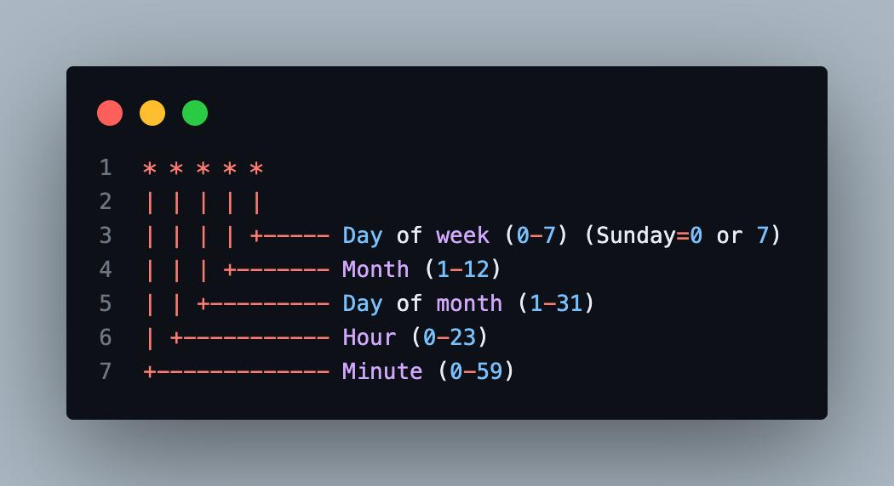

<p align="center">
  
</p>

<h1 align="center">ui_guard</h1>

<p align="center">
  <a href="https://pub.dev/packages/ui_guard">
    
  </a>
  <a href="https://github.com/Tanvirul-swe/ui_guard/actions">
    
  </a>
  <a href="https://github.com/Tanvirul-swe/ui_guard">
    
  </a>
  <a href="https://flutter.dev">
    
  </a>
</p>

<p align="center">
  <strong>
    Widgets that make role, permission, condition, policy, and time-based UI control
    <em>simple, scalable,</em> and <em>flexible</em>.
  </strong>
  <br>
  Built entirely in Dart to help you create smarter, access-aware Flutter applications.
</p>

<p align="center">
  <em>✨ ui_guard works seamlessly with any role management logic or state management approach.</em>
</p>

---

## 🔐 Why use ui_guard?

In many Flutter applications, you need to control access to certain parts of the UI.

For example:

* Show admin settings only to administrators
* Display upgrade buttons for guest or free users
* Hide actions when a user does not have the required permission
* Enable UI only when multiple access conditions are satisfied
* Reuse the same authorization rules across multiple screens
* Display UI only during a specific start/end time
* Enable features according to cron-style schedules
* React automatically when roles or permissions change
* Diagnose exactly why access was denied

`ui_guard` makes these scenarios simple and declarative using Dart.

---

## ✨ Features

* ✅ Guard widgets or entire screens based on roles
* 🔑 Permission-based access control
* 🧩 Combine roles, permissions, and runtime conditions
* ♻️ Reusable authorization policies with `AccessPolicy`
* 🔄 Reactive role and permission updates with `GuardNotifier`
* 🔍 Access diagnostics with `AccessDecision`
* 🧪 Developer override mode for development and testing
* 📦 Pure Dart — no platform-specific dependencies
* ♻️ Works with any state management approach
* ⏱️ Start/end time-based UI control
* 🕒 Cron-style scheduled UI access
* 🌍 Optional UTC schedule evaluation
* 🔔 Access decision callbacks for logging and debugging

---

## 📦 Installation

Add `ui_guard` to your `pubspec.yaml`:

```yaml
dependencies:
  ui_guard: ^1.1.0
```

Then run:

```bash
flutter pub get
```

Import the package:

```dart
import 'package:ui_guard/ui_guard.dart';
```

---

# 🚀 Quick Start

Use `GuardNotifier` when you want the UI to rebuild automatically after role or permission updates.

```dart
import 'package:flutter/material.dart';
import 'package:ui_guard/ui_guard.dart';

final guard = GuardNotifier()
  ..setUserRoles(['guest'])
  ..setUserPermissions([]);

class ExampleView extends StatelessWidget {
  const ExampleView({super.key});

  @override
  Widget build(BuildContext context) {
    return AccessGuard(
      guard: guard,
      rebuildListenable: guard,
      requiredRoles: const ['admin'],
      builder: (_) => const Text('Admin content'),
      fallbackBuilder: (_) => const Text('Access denied'),
    );
  }
}
```

When the roles or permissions inside `GuardNotifier` change, widgets using:

```dart
rebuildListenable: guard
```

can automatically rebuild.

---

# 🧭 Which Widget Should You Use?

| Need                                            | Widget                         |
| ----------------------------------------------- | ------------------------------ |
| Show/hide a full section or page by role        | `AccessGuard`                  |
| Show/hide a small inline widget by role         | `RoleBasedView`                |
| Require roles + permissions + runtime condition | `CombinedGuard`                |
| Reuse named authorization rules across screens  | `PolicyGuard` + `AccessPolicy` |
| Enable content only in a start/end time window  | `TimedAccessGuard`             |
| Enable content using a cron schedule            | `ScheduleGuard`                |

---

# 🧠 Core API

## 🔹 1. Define Access State

`ui_guard` provides both non-reactive and reactive guard state.

### Basic — `Guard`

Use `Guard` when automatic UI rebuilding is not required.

```dart
final guard = Guard();

guard.setUserRoles(['admin']);
guard.setUserPermissions(['users.edit']);
```

You can access the current roles:

```dart
print(guard.currentRoles);
```

---

### Reactive — `GuardNotifier`

For Flutter UI, `GuardNotifier` is recommended when roles or permissions can change while the application is running.

```dart
final guard = GuardNotifier();

guard.setUserRoles(['admin']);
guard.setUserPermissions(['users.edit']);
```

Use it with:

```dart
rebuildListenable: guard
```

Example:

```dart
AccessGuard(
  guard: guard,
  rebuildListenable: guard,
  requiredRoles: const ['admin'],
  builder: (_) => const Text('Admin Panel'),
  fallbackBuilder: (_) => const Text('Access Denied'),
);
```

---

# 🔐 Role-Based Access

## 🔹 2. `AccessGuard`

Use `AccessGuard` when you want to protect a complete widget, section, or page.

```dart
AccessGuard(
  guard: guard,
  rebuildListenable: guard,
  requiredRoles: const ['admin'],
  builder: (_) => const AdminPanel(),
  fallbackBuilder: (_) => const Text('No access'),
);
```

If you are using the non-reactive `Guard`, simply remove:

```dart
rebuildListenable: guard
```

Example:

```dart
AccessGuard(
  guard: guard,
  requiredRoles: const ['admin'],
  builder: (_) => const Text('Admin Panel'),
  fallbackBuilder: (_) => const Text('Access Denied'),
);
```

---

## 🔹 3. `RoleBasedView`

Use `RoleBasedView` when you need to show or hide a smaller inline widget.

```dart
RoleBasedView(
  guard: guard,
  rebuildListenable: guard,
  requiredRoles: const ['guest'],
  child: const Text('Guest banner'),
  fallback: const SizedBox.shrink(),
);
```

Another example:

```dart
RoleBasedView(
  guard: guard,
  requiredRoles: const ['admin', 'moderator'],
  child: const Text('Admin & Moderator Content'),
  fallback: const Text(
    'You do not have permission to view this content.',
  ),
);
```

---

## 🔹 4. `RoleGuard`

`RoleGuard` provides utility methods for common role checks.

```dart
RoleGuard.hasAnyRole(
  ['admin'],
  ['admin', 'user'],
); // true
```

```dart
RoleGuard.hasAllRoles(
  ['admin', 'editor'],
  ['admin'],
);
```

Use these utilities when you need role checking outside guard widgets.

---

# 🧩 Combined Access Conditions

## 🔹 5. `CombinedGuard`

Use `CombinedGuard` when access depends on multiple requirements.

It can combine:

* Roles
* Permissions
* Runtime conditions

Example:

```dart
CombinedGuard(
  guard: guard,
  rebuildListenable: guard,
  requiredRoles: const ['manager'],
  requiredPermissions: const ['team.edit'],
  condition: () => isInternalMode,
  builder: (_) => const TeamEditor(),
  fallbackBuilder: (_) => const Text('Requirements not met'),
);
```

This is useful when a role alone is not enough to determine whether content should be available.

For example:

```dart
CombinedGuard(
  guard: guard,
  requiredRoles: const ['manager'],
  requiredPermissions: const ['edit_team'],
  condition: () => organization.isInternalMode,
  builder: (_) => const TeamEditor(),
  fallbackBuilder: (_) => const Text('Access Restricted'),
);
```

---

# ♻️ Reusable Access Policies

## 🔹 6. `AccessPolicy` + `PolicyGuard`

When the same authorization rule is used in multiple places, define it once as an `AccessPolicy`.

```dart
const manageUsersPolicy = AccessPolicy(
  name: 'manage_users',
  requiredRoles: ['admin'],
  requiredPermissions: ['users.edit'],
);
```

Then reuse the policy:

```dart
PolicyGuard(
  guard: guard,
  rebuildListenable: guard,
  policy: manageUsersPolicy,
  builder: (_) => const Text('User manager'),
  fallbackBuilder: (_) => const Text('No access'),
);
```

This keeps authorization rules centralized and avoids repeating the same role and permission requirements across your application.

Example use cases include:

* User management
* Payment administration
* Moderator tools
* Organization settings
* Restricted reports
* Feature management

---

# 🔍 Access Diagnostics

## 🔹 7. `AccessDecision`

Sometimes hiding a widget is not enough — you also need to understand **why** access was denied.

The `onDecision` callback provides an `AccessDecision`.

It can include information such as:

* `allowed`
* `missingRoles`
* `missingPermissions`
* `failedCondition`
* `reasonCode`

Example:

```dart
CombinedGuard(
  guard: guard,
  requiredRoles: const ['manager'],
  onDecision: (decision) {
    if (!decision.allowed) {
      debugPrint('Missing roles: ${decision.missingRoles}');
      debugPrint(
        'Missing permissions: ${decision.missingPermissions}',
      );
      debugPrint(
        'Failed condition: ${decision.failedCondition}',
      );
      debugPrint('Reason code: ${decision.reasonCode}');
    }
  },
  builder: (_) => const Text('Manager area'),
  fallbackBuilder: (_) => const Text('Denied'),
);
```

This is especially useful for:

* Debugging authorization problems
* Analytics
* Logging
* Access auditing
* Development diagnostics

---

# 🧪 Developer Override Mode

During development or automated/manual testing, you may temporarily bypass guard restrictions.

```dart
GuardConfig.developerOverrideEnabled = true;
```

When enabled, guard checks are bypassed.

> ⚠️ Developer override should only be used during development or testing.

Before production, make sure it is disabled:

```dart
GuardConfig.developerOverrideEnabled = false;
```

---

# ⏱️ Time-Based Access

## 🔹 8. `TimedAccessGuard`

Use `TimedAccessGuard` when content should only be available between a start and end time.

Ideal for:

* 🎁 Limited-time offers
* ⚡ Flash sales
* 🧪 Beta or trial features
* 🔧 Maintenance notices
* 📅 Event-specific content
* 🛍️ Daily or weekly deals
* 📢 Time-based announcements
* 🏢 Business-hour features

Example:

```dart
TimedAccessGuard(
  start: DateTime(2026, 3, 29, 9),
  end: DateTime(2026, 3, 29, 18),
  checkInterval: const Duration(seconds: 1),
  onTimeUpdate: (remaining) {
    debugPrint(
      'Remaining: ${remaining.inSeconds}s',
    );
  },
  builder: (_) => const Text('Offer active'),
  fallbackBuilder: (_) => const Text('Offer closed'),
);
```

Another example:

```dart
TimedAccessGuard(
  start: DateTime(2026, 7, 18, 9),
  end: DateTime(2026, 7, 18, 13),
  checkInterval: const Duration(seconds: 1),
  onTimeUpdate: (remaining) {
    debugPrint(
      '⏱️ Time left: ${remaining.inSeconds}s',
    );
  },
  builder: (_) => const PromoBanner(),
  fallbackBuilder: (_) => const SizedBox.shrink(),
);
```

---

# 🕒 Scheduled Access with `ScheduleGuard`

`ScheduleGuard` controls UI visibility using cron-style schedules.

Example:

```dart
ScheduleGuard(
  schedule: '*/15 9-17 * * MON-FRI',
  useUtc: true,
  checkInterval: const Duration(minutes: 1),
  builder: (_) => const Text('Business hours'),
  fallbackBuilder: (_) => const Text('Outside business hours'),
);
```

Another example:

```dart
ScheduleGuard(
  schedule: '0 9 * * 1-5',
  builder: (_) => const Text('Business is open!'),
  fallbackBuilder: (_) => const Text('Closed right now.'),
);
```

---

## 🧠 How Cron Scheduling Works

`ScheduleGuard` supports the standard **5-field cron format**:

```text
minute hour day month weekday
```

<p align="center">
  
</p>

### Supported cron capabilities

* Wildcards

```text
*
```

* Lists

```text
1,2,3
```

* Ranges

```text
1-5
```

* Steps

```text
*/5
```

* Month aliases

```text
JAN
FEB
MAR
```

* Day aliases

```text
MON-FRI
```

* Cron macros such as:

```text
@daily
@weekly
@hourly
```

The guard can automatically re-evaluate according to the provided:

```dart
checkInterval
```

You can also choose whether scheduling should be evaluated using UTC:

```dart
useUtc: true
```

---

## 🕒 `ScheduleGuard` Use Cases

`ScheduleGuard` can be useful for:

* 🕘 Enable features during business hours
* 🏷️ Display promotional banners during selected hours
* 🛠️ Hide functionality during maintenance windows
* ⏰ Enable actions only at specific scheduled times
* 📢 Display scheduled announcements
* 📅 Enable weekday-only functionality
* 🛒 Run time-limited promotions
* 💬 Enable customer support/chat during office hours

---

# 📱 Example App

A complete working example is available in:

[`example/`](example)

The example application demonstrates:

* `Guard`
* `GuardNotifier`
* Reactive guard updates
* Role changes at runtime
* Permission changes at runtime
* `AccessGuard`
* `RoleBasedView`
* `CombinedGuard`
* `PolicyGuard`
* `AccessPolicy`
* `AccessDecision`
* `onDecision` diagnostics
* `TimedAccessGuard`
* `ScheduleGuard`
* Developer override behavior

You can explore the example project to understand how the different guards can work together in a real Flutter application.

---

# 🧩 Common Use Cases

| Use Case                 | Example                                              |
| ------------------------ | ---------------------------------------------------- |
| Admin-only screens       | `requiredRoles: ['admin']`                           |
| Guest-specific UI        | Display upgrade or login actions                     |
| Feature restrictions     | Hide paid features from free users                   |
| Auth state UI            | Show different actions based on access state         |
| Nested permissions       | Combine moderator/admin roles                        |
| Permission-based actions | Require permissions such as `users.edit`             |
| Read-only vs edit access | Conditionally render edit buttons or fields          |
| Subscription tiers       | Control access for `free`, `premium`, or `pro` users |
| Combined logic           | Roles + permissions + runtime conditions             |
| Reusable policies        | Share authorization rules with `AccessPolicy`        |
| Access diagnostics       | Detect missing roles or permissions                  |
| Developer override       | Skip restrictions during development/testing         |
| Time-based access        | Use `TimedAccessGuard`                               |
| Scheduled access         | Use `ScheduleGuard`                                  |
| Business hours           | Enable UI using cron schedules                       |
| Promotions               | Show content only during campaign periods            |

---

# 📚 API Exports

The main package export is:

```dart
import 'package:ui_guard/ui_guard.dart';
```

It includes the primary APIs required to use the package.

### Core

* `Guard`
* `GuardNotifier`
* `GuardConfig`
* `RoleGuard`
* `GuardUtils`

### Policies & Diagnostics

* `AccessPolicy`
* `AccessDecision`

### Widgets

* `AccessGuard`
* `RoleBasedView`
* `CombinedGuard`
* `PolicyGuard`
* `TimedAccessGuard`
* `ScheduleGuard`
* `GuardListenableBuilder`

---

# 🏗️ Example Architecture

A common application structure could look like:

```dart
final guard = GuardNotifier();

void configureUserAccess() {
  guard.setUserRoles([
    'manager',
  ]);

  guard.setUserPermissions([
    'team.view',
    'team.edit',
  ]);
}
```

Then anywhere in your application:

```dart
AccessGuard(
  guard: guard,
  rebuildListenable: guard,
  requiredRoles: const ['manager'],
  builder: (_) => const ManagerDashboard(),
  fallbackBuilder: (_) => const AccessDeniedView(),
);
```

For reusable business rules:

```dart
const editTeamPolicy = AccessPolicy(
  name: 'edit_team',
  requiredRoles: ['manager'],
  requiredPermissions: ['team.edit'],
);
```

Use it wherever required:

```dart
PolicyGuard(
  guard: guard,
  rebuildListenable: guard,
  policy: editTeamPolicy,
  builder: (_) => const EditTeamButton(),
  fallbackBuilder: (_) => const SizedBox.shrink(),
);
```

This keeps your UI access logic clean, reusable, and easier to maintain as the application grows.

---

# 💬 Contributing

Contributions are welcome! 🎉

Useful links:

* 🌐 [GitHub Repository](https://github.com/Tanvirul-swe/ui_guard)
* 🐛 [Report an Issue](https://github.com/Tanvirul-swe/ui_guard/issues)

To contribute:

1. Fork the repository
2. Create a new branch
3. Make your changes
4. Add or update tests where applicable
5. Commit your changes
6. Push your branch
7. Submit a pull request

---

# ☕ Support My Work

If you find `ui_guard` useful, consider supporting the project.

[](https://coff.ee/tanvir_swe)

Prefer mobile?

Scan the QR code below:

<p align="center">
  
</p>

Your support helps maintain and improve `ui_guard`. ❤️

---

# 👤 Maintainer

**MD. TANVIRUL ISLAM**

GitHub: [Tanvirul-swe](https://github.com/Tanvirul-swe)

---

<p align="center">
  Made with ❤️ for the Flutter community.
</p>
